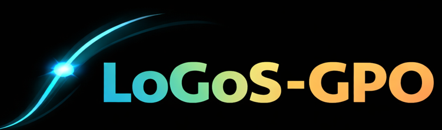
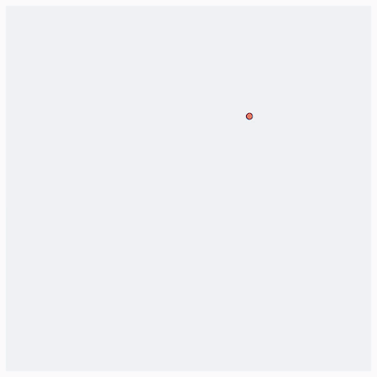
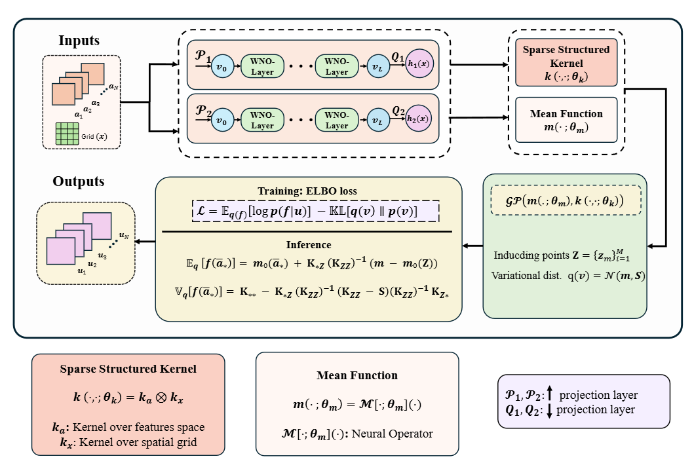
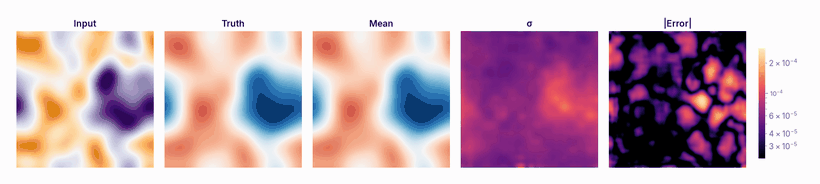
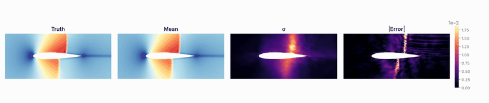
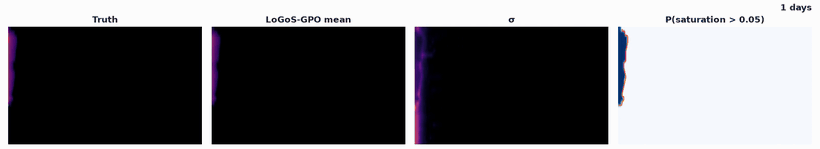
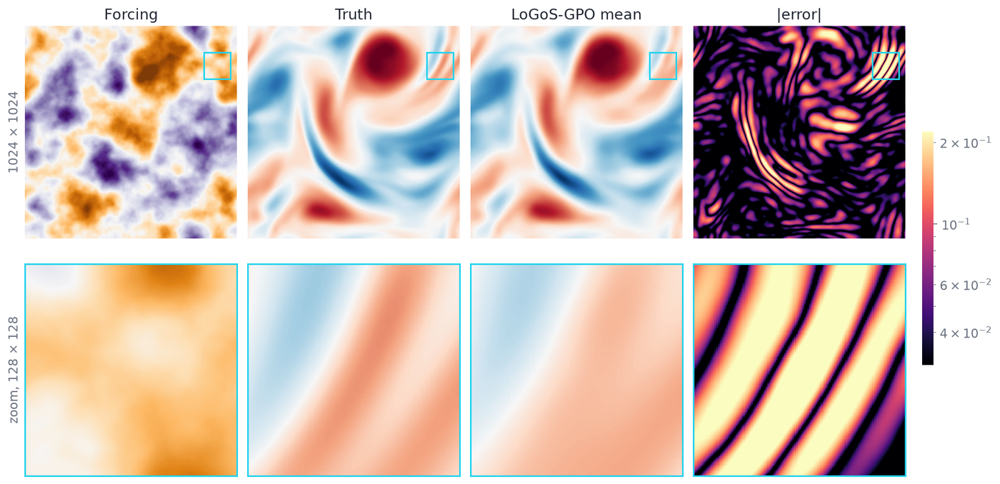

<p align="center">
  
</p>

<h1 align="center">From Local Interactions to Global Operators:<br>Scalable Gaussian Process Operator for Physical Systems</h1>

<p align="center">
  Sawan Kumar · Tapas Tripura · Rajdip Nayek · Souvik Chakraborty<br>
  <i>Journal of Computational Physics</i>, 2026
</p>

<p align="center">
  <a href="https://savnkr.github.io/LoGoS-GPO/"></a>
  <a href="https://www.sciencedirect.com/science/article/pii/S002199912600135X"></a>
  <a href="https://arxiv.org/abs/2506.15906"></a>
  <a href="#datasets-and-notebooks"></a>
</p>
<p align="center">
  <a href="LICENSE"></a>
  
  
</p>

<p align="center">
  
</p>

**LoGoS-GPO** is a probabilistic neural operator. It is a Gaussian process over functions whose mean is a neural
operator and whose covariance factorises into a kernel over inputs and a kernel over space, made sparse by nearest
neighbours (above: a field built one point at a time, each point conditioned on a few earlier neighbours). It keeps
the accuracy of the operator, adds calibrated uncertainty at every output point, and scales linearly with the grid.

> **Updated release.** Refined implementation with stronger results on every benchmark, input-adaptive uncertainty,
> new benchmarks and applications, and a [project page](https://savnkr.github.io/LoGoS-GPO/).

## Highlights

- **More accurate than the published results** on every paper benchmark, e.g. Navier–Stokes 2.01% → 0.21%.
- **Standard Darcy: 0.52%**, ahead of Transolver (0.57%), with calibrated uncertainty on top.
- **CO<sub>2</sub> storage**: keeps the accuracy of the state-of-the-art U-FNO and adds plume-risk forecasts 19% better
  than its deterministic plume.
- **A million outputs per field** on Navier–Stokes 1024², with uncertainty that ranks which fields are hard (ρ = 0.96).

## Method

<p align="center"></p>

The prior over output fields is

$$f(a) \sim \mathcal{GP}\big(\mathcal{M}[a],\; K_a(\Phi(a), \Phi(a')) \otimes K_x\big), \qquad y = f + \varepsilon,\quad \varepsilon \sim \mathcal{N}\big(0, \sigma^2(a, x)\big),$$

with a neural-operator mean $\mathcal{M}$, inducing points for sparsity across inputs and a nearest-neighbour
(Vecchia) form of $K_x$ for sparsity in space. The operator and the Gaussian process are trained together on a
closed-form evidence lower bound.

## Results

<p align="center"></p>
<p align="center"><sub>Navier–Stokes, forcing → vorticity: input, truth, mean, σ and |error| on held-out cases.</sub></p>

<p align="center"></p>
<p align="center"><sub>Transonic airfoil: σ concentrates on the shocks, where the error is.</sub></p>

<p align="center"></p>
<p align="center"><sub>CO<sub>2</sub> storage, 1 day to 30 years: truth, mean, σ and the probability that a cell holds
CO<sub>2</sub>.</sub></p>

<p align="center"></p>
<p align="center"><sub>Navier–Stokes at 1024 × 1024: all 1,048,576 outputs of a field, with a zoom on its hardest
region.</sub></p>

Tables, uncertainty scores, the scaling study and more galleries are on the
[project page](https://savnkr.github.io/LoGoS-GPO/).

## Installation

```bash
git clone https://github.com/csccm-iitd/SGPO.git
cd SGPO
pip install -r requirements.txt
```

## Datasets and notebooks

Each notebook loads one benchmark, explains the mapping and plots samples. Where to download (or how to generate)
each dataset from its official source is described in [`data/data.md`](data/data.md).

| Benchmark | Mapping | Notebook |
|---|---|---|
| Burgers | u(x, 0) → u(x, 1) | [](https://colab.research.google.com/github/csccm-iitd/SGPO/blob/master/notebooks/data_burgers.ipynb) |
| Wave advection | u(x, 0) → u(x, t) | [](https://colab.research.google.com/github/csccm-iitd/SGPO/blob/master/notebooks/data_advection_paper.ipynb) |
| Darcy, notched domain | boundary condition → pressure | [](https://colab.research.google.com/github/csccm-iitd/SGPO/blob/master/notebooks/data_darcy_notch.ipynb) |
| Navier–Stokes 64² | forcing → vorticity | [](https://colab.research.google.com/github/csccm-iitd/SGPO/blob/master/notebooks/data_ns_forcing.ipynb) |
| CO<sub>2</sub> storage | reservoir → saturation history | [](https://colab.research.google.com/github/csccm-iitd/SGPO/blob/master/notebooks/data_co2.ipynb) |
| Navier–Stokes 1024² | forcing → vorticity | [](https://colab.research.google.com/github/csccm-iitd/SGPO/blob/master/notebooks/data_ns1024.ipynb) |

## Quick start

Training has two stages: the neural-operator mean, then the Gaussian process on top of it. For Navier–Stokes:

```bash
python experiments/train_operator.py --data ns_forcing --ntrain 3000 --nval 200 --ntest 100 --arch wnof \
    --level 2 --wavelet db6 --modes 16 16 --width 48 --layers 4 --epochs 200 --batch 32 --lr 0.0003 --out runs/ns/op
python experiments/train_logos_vnngp.py --init runs/ns/op --epochs 100 --batch 16 --lr-op 3e-05 \
    --freeze-frac 0.3 --noise feature --out runs/ns/logos
```

Both stages checkpoint and resume. `runs/ns/logos/metrics.json` reports the test error and the uncertainty scores
(NLL, CRPS, coverage). Commands for every result above are in [`scripts/reproduce.sh`](scripts/reproduce.sh).

## Repository layout

```
sgpo/models/       LoGoS-GPO (logos_vnngp.py) and the GPO baseline
sgpo/operators/    neural-operator means: WNO, FNO, EWNO; Fourier resampling; symmetry helpers
sgpo/uq/           kernels, nearest-neighbour (Vecchia) graph, uncertainty metrics
sgpo/data/         loaders for every benchmark
experiments/       training (operator, LoGoS-GPO, GPO), evaluation and figures
scripts/           dataset download/generation, reproduce.sh
notebooks/         one notebook per dataset
```

## Citation

```bibtex
@article{kumar2026logosgpo,
  title   = {From Local Interactions to Global Operators: Scalable Gaussian Process Operator for Physical Systems},
  author  = {Kumar, Sawan and Tripura, Tapas and Nayek, Rajdip and Chakraborty, Souvik},
  journal = {Journal of Computational Physics},
  year    = {2026},
  eprint  = {2506.15906},
  archivePrefix = {arXiv}
}
```
